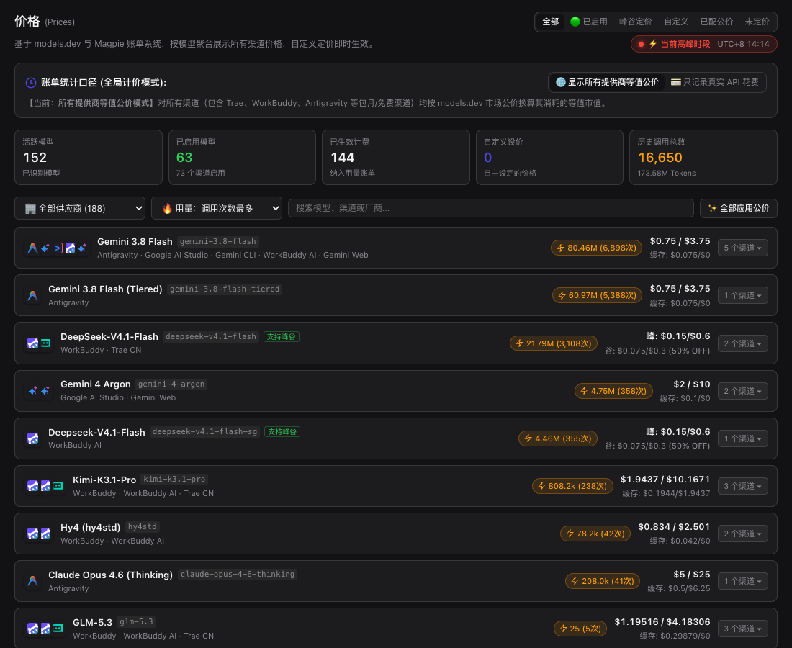
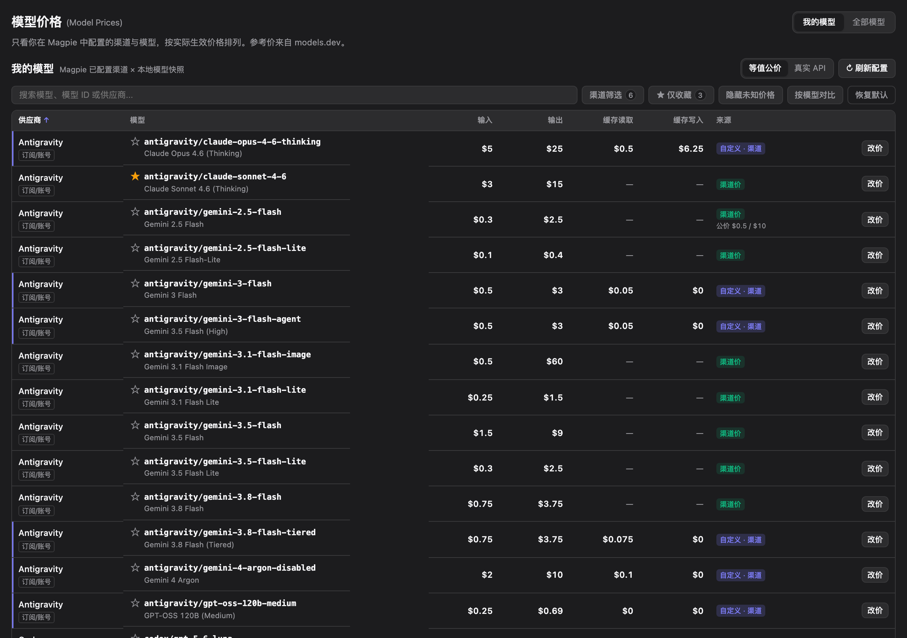
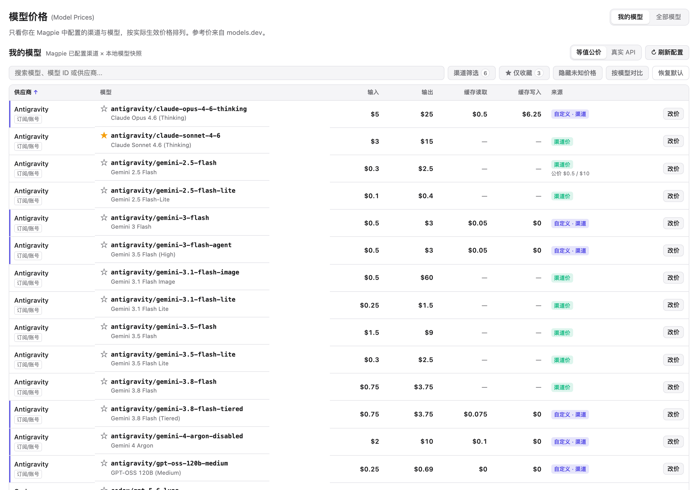
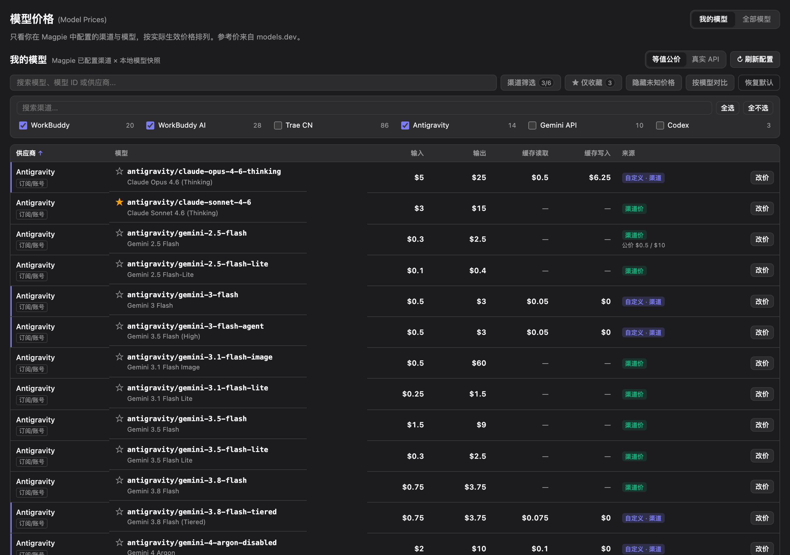
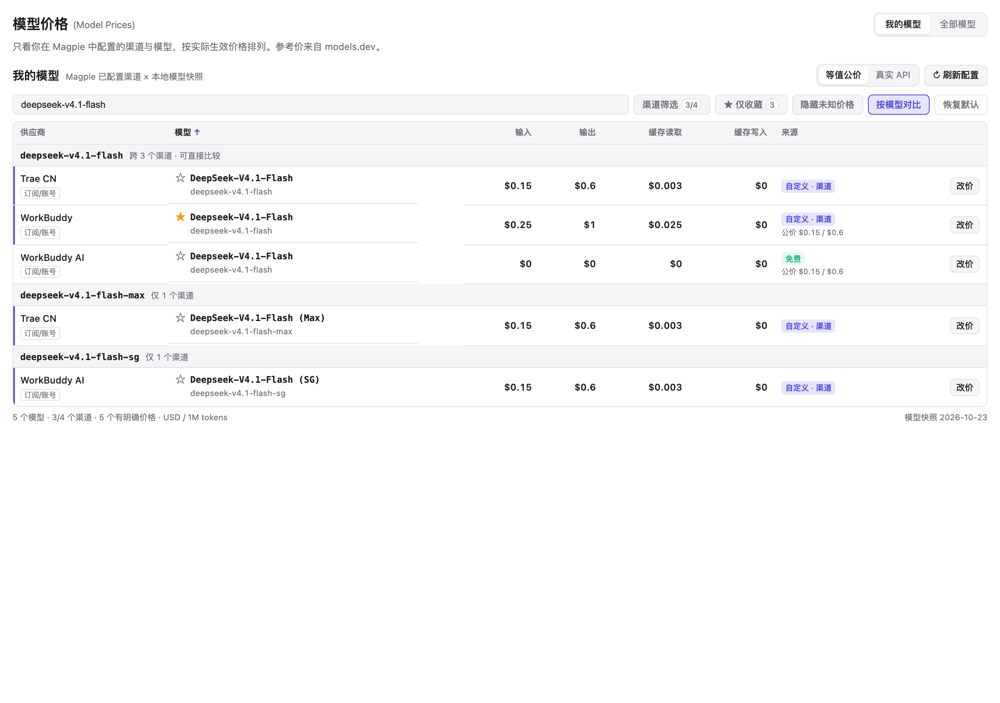
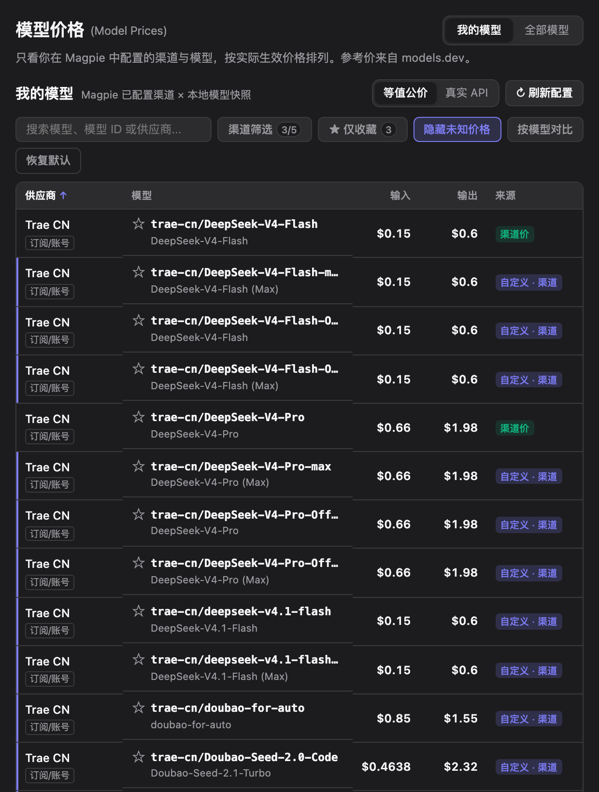

# 模型价格 (Model Prices)

一个 Magpie 页面插件，基于 [models.dev](https://models.dev) 官方公价数据库与 Magpie 原版账单系统，自动匹配模型官方价格、自定义设价，并支持一键切换真实 API 花费口径。



## 功能特性

- **侧边栏独立页面**：无缝嵌入 Magpie 侧边栏「模型价格」标签页，界面完全贴合 Magpie 原生风格与主题。
- **我的模型面板**：只展示 Magpie 中已配置渠道的模型，支持渠道多选、搜索、收藏、排序与跨渠道价格对比。
- **账单统计口径切换**：
  - **只记录真实 API 花费**：包月、订阅与免费额度渠道（如 Trae, WorkBuddy, Antigravity）免计费（$0.00），精准记录掏现金的 API 支出；
  - **显示所有渠道等值公价**：将所有模型消耗按市场公价换算等值市值，清晰掌握各渠道抵扣价值。
- **公价自动匹配**：自动比对识别未定价模型，提供原厂官方公价参考并支持一键全量应用。
- **灵活自定义定价**：
  - 支持指定特定渠道独立调价（如 `antigravity/claude-sonnet-4-6`）；
  - 支持全网通配调价（如 `*/claude-sonnet-4-6`）。
- **即时生效与账单联动**：设定即时写入底层配置，每日用量看板、会话统计与托盘花费实时更新生效。
- **轻量纯静态架构**：脱离子进程与外部命令，纯本地文件直读直写，零内存与 CPU 额外开销。
- **响应式布局**：完美适配窄屏与极窄窗口，按钮与内容流式自适应排版。

## 我的模型 / My Models

### 为什么增加这个面板

原有页面按「全部模型」展示所有渠道，适合集中维护价格；但日常查看时，用户通常只关心自己配置的少数渠道和实际使用的模型。**我的模型** 把范围收窄到 Magpie 当前配置的渠道，并默认作为打开插件后的第一个视图。原来的「全部模型」、公价匹配、自定义定价和统计口径切换都保留不变。

### 数据从哪里来

- **已配置渠道**：通过 Magpie 页面桥接的 `providers:list` 读取，只包含渠道 `id` 与名称。
- **渠道下的模型**：优先读取宿主写入的实时快照 `page/models-live.js`（由 `price.hooks.mjs` 定期扫描本机 Magpie 模型缓存生成）；若尚未就绪则回退到随包快照 `page/models-data.js`。
- **实际生效价格**：优先使用插件选项中的渠道自定义价 / 通配自定义价，其次是 Magpie `settings.json` 中已经写入的列表价或自定义价。
- **官方参考价**：models.dev 匹配结果只作为参考显示，不会冒充当前渠道的实际价格。

> Magpie 的页面 API 目前不暴露「单个模型是否启用」的标记，因此面板展示的是「已配置渠道 × 本地/实时模型快照」这一最准确的可验证集合，并在页面底部与提示条中说明依据。若某个已配置渠道暂时不在快照中，页面会明确提示；宿主会自动扫描本机缓存，点「↻ 刷新配置」即可加载最新快照，而不是要求用户手工跑 CLI。

### 进入页面

在 Magpie 侧边栏打开「模型价格」，顶部切换到 **我的模型**。默认就是该视图；**全部模型** 保留了原页面的全部能力。

### 筛选、搜索与收藏

- **渠道筛选**：仅列出 Magpie 中实际配置的渠道，可全选、全不选、搜索和记住上次选择；渠道被删除后会自动从筛选中移除。
- **搜索**：同时匹配模型名称、模型 ID、显示名与渠道名称。
- **收藏**：按「渠道 + 模型」独立收藏，不改变 Magpie 的路由或启用状态；收藏会写入插件选项，跨重启保留。失效模型的收藏会被安全保留并提示，不会影响其他模型。
- **隐藏未知价格**：只保留有明确价格或官方参考价的模型。
- **恢复默认**：清空搜索、渠道筛选、收藏筛选、隐藏与分组状态，但不会删除收藏。

### 跨渠道价格对比

点击 **按模型对比**，表格会按相同的模型 ID 分组，把不同渠道的价格放在同一组内直接比较。例如同一个 `deepseek-v4.1-flash` 在 WorkBuddy、WorkBuddy AI 与 Trae CN 下的输入/输出/缓存价格会分别列出。

分组只合并完全相同的模型 ID，不会按模型名猜测或合并别名；无法确认是否同一模型时保持独立。

### 价格来源

| 来源 | 含义 |
|---|---|
| 自定义 · 渠道 | 针对 `渠道/模型` 写入的自定义价格，优先级最高 |
| 自定义 · 通配 | 针对 `*/模型` 写入的价格，作用于所有未单独设价的渠道 |
| 渠道价 | Magpie 渠道自己的列表价 |
| 免费 / 订阅 · 免计费 | 免费模型；或「只记录真实 API 花费」模式下订阅渠道按 $0 计 |
| 官方参考（未应用） | models.dev 的参考价，尚未写入账单，仅以弱化样式展示 |
| 未知 | 没有可验证价格，显示 `—`，不会当作 0 |

当实际价格与 models.dev 参考价不同时，来源下方会额外显示参考价；相同时不重复展示。

### 刷新数据

- **↻ 刷新配置**：重新读取 Magpie 的渠道列表、插件选项与账单口径，并尝试加载宿主刚写入的 `page/models-live.js` 实时模型快照，不需要重启 Magpie，也不需要手工跑 CLI。
- **自动更新模型快照**：插件通过 `magpie.hooks`（`price.hooks.mjs`）在 Magpie 宿主进程中定期扫描 `~/.cache/magpie`，把最新渠道/模型写入页面旁的 `models-live.js`。页面沙箱无法联网或访问本机缓存，因此采用与 Agent Office 相同的「宿主写文件 → 页面重新加载文件」模式。
- **随包快照兜底**：发布包仍包含 `page/models-data.js`。若宿主 hooks 尚未就绪，页面会继续使用随包快照，并在提示中说明。开发者仍可用 `node page/generate-data.js` 更新随包快照。刷新快照不会自动覆盖用户在 Magpie 中设置的渠道自定义价。

### 截图

| 我的模型（暗色） | 我的模型（亮色） |
|---|---|
|  |  |

| 渠道筛选 | 跨渠道对比 | 窄窗口 |
|---|---|---|
|  |  |  |

截图来自插件真实页面代码，使用仓库自带的快照数据与本地 bridge 渲染，不包含 API Key、账户或私人配置。

## 命令行工具（可选）

页面主要通过图形界面直接操作，同时也支持在终端作为轻量 CLI 脚本运行：

```bash
# 查看所有模型匹配与定价状态
node index.js list

# 切换统计口径为仅记录 API 真实花费
node index.js mode api-only

# 切换统计口径为显示所有渠道等值公价
node index.js mode all

# 一键将所有 models.dev 建议公价写入 Magpie
node index.js sync

# 预览拟同步的设价命令（不实际写入）
node index.js sync --dry-run
```

## 许可证
MIT License © zrtzrt
