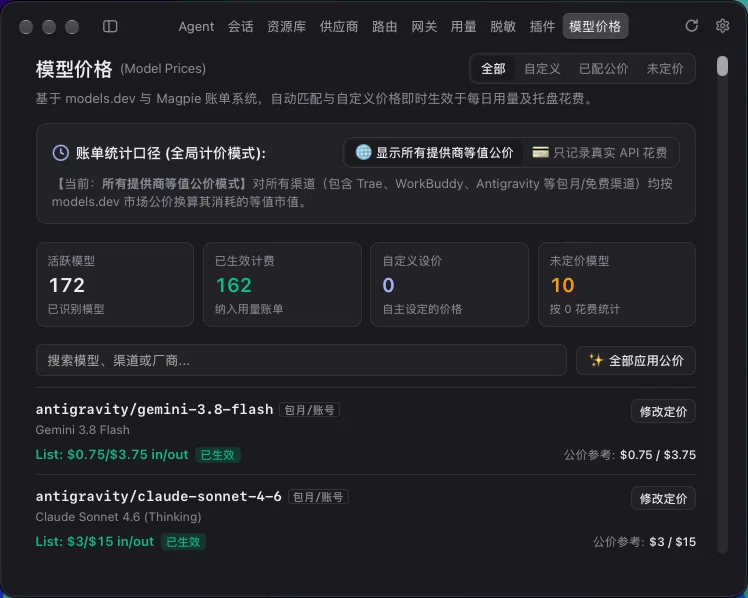

# 模型价格 (Model Prices)

一个 Magpie 页面插件，基于 [models.dev](https://models.dev) 官方公价数据库与 Magpie 原版账单系统，自动匹配模型官方价格、自定义设价，并支持一键切换真实 API 花费口径。



## 功能特性

- **侧边栏独立页面**：无缝嵌入 Magpie 侧边栏「模型价格」标签页，界面完全贴合 Magpie 原生风格与主题。
- **账单统计口径切换**：
  - **只记录真实 API 花费**：包月、订阅与免费额度渠道（如 Trae, WorkBuddy, Antigravity）免计费（$0.00），精准记录掏现金的 API 支出；
  - **显示所有渠道等值公价**：将所有模型消耗按市场公价换算等值市值，清晰掌握各渠道抵扣价值。
- **公价自动匹配**：自动比对识别未定价模型，提供原厂官方公价参考并支持一键全量应用。
- **灵活自定义定价**：
  - 支持指定特定渠道独立调价（如 `antigravity/claude-sonnet-4-6`）；
  - 支持全网通配调价（如 `*/claude-sonnet-4-6`）。
- **即时生效与账单联动**：设定即时写入底层配置，每日用量看板、会话统计与托盘花费实时更新生效。
- **轻量纯静态架构**：脱离子进程与外部命令，纯本地文件直读直写，零内存与 CPU 额外开销。
- **响应式布局**：完美适配窄屏与极窄窗口，按钮与内容流式自适应排版。

## 命令行工具（可选）

页面主要通过图形界面直接操作，同时也支持在终端作为轻量 CLI 脚本运行：

```bash
# 查看所有模型匹配与定价状态
node index.js list

# 切换统计口径为仅记录 API 真实花费
node index.js mode api-only

# 切换统计口径为显示所有渠道等值公价
node index.js mode all

# 一键将所有 models.dev 建议公价写入 Magpie
node index.js sync

# 预览拟同步的设价命令（不实际写入）
node index.js sync --dry-run
```

## 许可证
MIT License © zrtzrt
