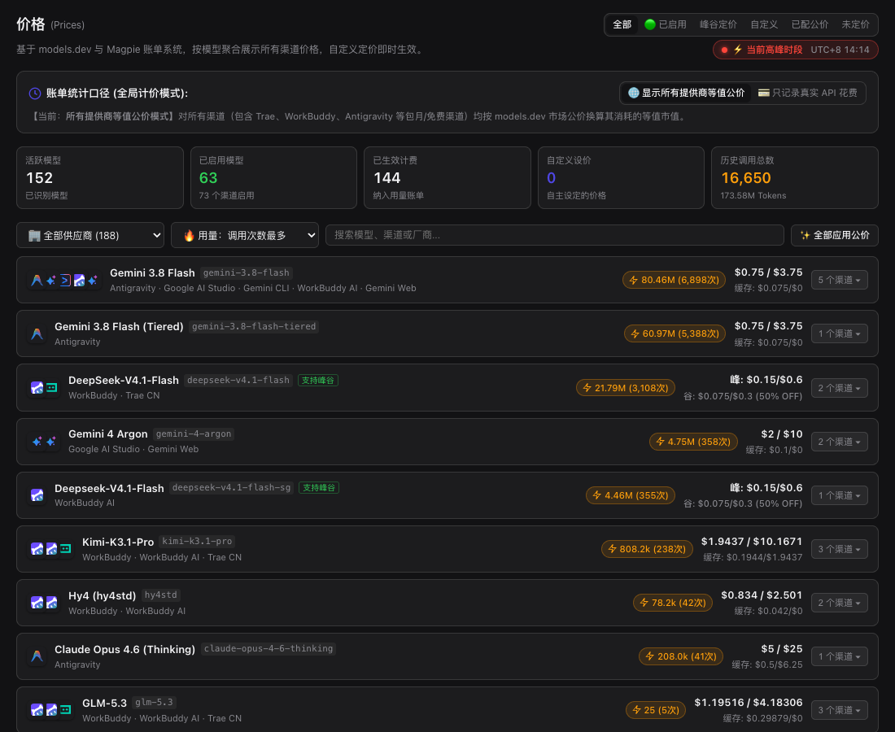

# 价格 (Magpie Models Price)

一个 **页面插件**（`magpie.page`）的 Magpie 模型价格与用量面板：读取 [models.dev](https://models.dev) 公价与 Magpie 本地账单/用量（`usage.jsonl`），按模型聚合展示所有渠道价格、上下文用量与真实 API 花费。页面不注册任何供应商（provider），但自带一个宿主部分（`index.js`），由它把页面保存的价格自动写进 Magpie。



## 页面 + 宿主，而不是纯页面

Magpie 的页面跑在沙盒里（`connect-src 'none'`）：页面只能 `magpie.read` 读用量、`magpie.options` 保存自己的选项，**写不了** `settings.json`。所以本插件由两部分组成：

| 部分 | 文件 | 做什么 |
| --- | --- | --- |
| 页面 | `page/index.html` + `page/app.js` | 展示与编辑；保存写入插件 options（`plugins.json`） |
| 宿主 | `index.js` | 轮询插件 options，把页面保存的价格写进 `settings.json`；重建页面模型清单；写状态文件 |

宿主是**可选**的：`internal/plugin/page.go` 里 `Service` 与 `hosted` 都只看 `main` / `exports` 是否存在，`internal/gui/pluginpage.go` 在你**打开这个页面时**才拉起宿主（`pageHost` → `plugin.Warm`）。所以打开页面、改价、保存，几秒内就会落盘，不需要记任何命令。

插件仍然**不是供应商**：宿主导出的 `config()` 是空实现，Magpie 不会为它列出供应商、模型或中间件；插件列表里只有「页面」徽章。

## 安装与使用

```bash
magpie plugin add magpie-models-price
```

装完直接打开顶栏「价格」页即可：

1. 首次打开时宿主在后台生成模型清单（`page/models-data.js`），页面会重试加载并在生成后自动重绘；
2. 改价保存后，宿主在 2 秒内把改动写进 `settings.json`，并把「真实回读结果」写进 `page/price-status.js`；
3. 页面读回该状态，告诉你价格是否真的生效——不是「已保存」这种一厢情愿的提示。

## 功能特性

- **按模型聚合展示**：同一原生模型（如 `gemini-3.8-flash`）自动归并为一张卡片，展示所有供应商渠道与重叠图标。
- **真实用量与 Token 统计**：通过 `usage:day`（全量历史）与 `usage:summary`（today/7d/30d）读取，打开、聚焦与每 30 秒自动刷新。
- **已启用筛选**：一键过滤当前已启用的活跃模型与渠道。
- **渠道类型筛选**：按 `billingKind=payg` 与 `key.set` 区分「付费 API」和「账号登录」。
- **多维度排序**：智能排序（在用优先，同档按 Token 降序）、调用次数、Token 消耗、价格高低、渠道数、名称。
- **模型后缀智能归类**：`-max` / `-auto` / `-official` / `-highspeed` / 日期快照 / `-antidowngrade` 等变体归为一族；`qwen4` 与 `qwen4-max` 这种同名不同价不会被误并。
- **分时峰谷计价（模型级设置）**：官方价目里真正分时的是 DeepSeek 系模型，默认工作日 09:00-12:00 / 14:00-18:00（Ollama Cloud 为 12:00-18:00 UTC）×2；其他模型全天同价，可在弹窗单独开启并自定义时段与倍率。保存时会汇总同步到 Magpie `providers.json` 的渠道 `rateWindows`（Magpie 只支持渠道级时段，冲突时保持原样并报告）。
- **口径提醒**：编辑弹窗顶部常驻横幅与「闲时价 / 高峰价」角标，填高峰价时明确展示 ÷倍率换算；写进 `settings.json` 的始终是闲时价，高峰由 Magpie 的 rateWindows 计费。
- **账单统计口径切换**：只记录真实 API 花费（订阅/免费渠道 $0）或显示所有渠道等值公价；历史用量按当前 `modelPrices` 重算。
- **公价自动匹配**：自动比对未定价模型，支持一键填入全部公价。
- **自定义定价**：支持单渠道定价（`antigravity/claude-sonnet-4-6`）与全网通配（`*/claude-sonnet-4-6`）。
- **原子写入**：写 `settings.json` 时用临时文件 + rename，只合并 `modelPrices`，不覆盖其他设置。
- **只写你改过的键**：页面保存只应用本次改动的价格，不动你在 Magpie 自己编辑器里设的价格，也不给你没有的 provider 添加价格。

## 配置目录

| 用途 | 位置 |
| --- | --- |
| 价格、插件 options | `$XDG_CONFIG_HOME/magpie/`，未设置时 `~/.config/magpie/` |
| models.dev 缓存 | `$XDG_CACHE_HOME/magpie/`，未设置时 `~/.cache/magpie/` |
| 主目录 | `HOME`；Windows 上为 `USERPROFILE` |

`XDG_*` 只有写成绝对路径才生效（与宿主 `internal/appdir` 的判断一致），相对值会被忽略并回落到主目录。首次运行时 `~/.config/magpie` 尚不存在也会自动创建。

宿主不监听任何端口（没有 `page.service`），只读写文件。

**读权限**：manifest 只声明 `usage:summary` / `usage:day`，不申请 `providers:list`；供应商名称与启用状态由宿主生成进 `page/models-data.js`。

## 命令行工具（可选）

宿主已经替你做了这些事，CLI 只是给脚本、CI 或无界面场景兜底：

```bash
magpie-models-price sync [--force]   # 生成页面数据（模型变化后手动刷新）
magpie-models-price apply            # 应用页面保存的价格与峰谷（幂等）
magpie-models-price watch            # 常驻：自动 apply + 刷新页面数据
magpie-models-price doctor           # 显示实际路径和状态
magpie-models-price list             # 列出未定价模型与建议公价
magpie-models-price mode api-only    # 切换统计口径（仅 API 花费）
magpie-models-price mode all         # 切换统计口径（全部等值公价）
magpie-models-price match-public     # 把 models.dev 公价应用到全部未定价模型
magpie-models-price set <model> <in,out,cache_read,cache_write>
magpie-models-price reset <model>
magpie-models-price ui               # 可选独立 Web 控制台（127.0.0.1:3456）
```

## 开发与测试

```bash
node check.js      # 19 组自测：目录解析、保存只写改动、清单与宿主、CLI、服务边界、页面 CSP
```

CI 在 ubuntu / macOS / Windows 三平台 × Node 20/22/24 跑同一套测试，并检查打包产物不含任何本地配置。

## 升级说明

### v2 → v2.1

v2.1.0 把 `index.js` 加回来了，但**不是** v1 的供应商入口：它只答一个空 `config()`，不注册 provider、不监听端口，只做「应用页面保存的价格」和「生成模型清单」。因此：

1. 升级后**不需要**再跑 `npx magpie-models-price sync` 或 `apply`，打开页面即可；
2. 插件列表仍只显示「页面」徽章，不会多出供应商；
3. 关掉插件时宿主一起停，不会有残留进程。

### v1 → v2

v2.0.0 移除了旧的 provider 服务端入口与 `providers:list` 权限，插件行不再显示「供应商」徽章。

## 许可证
MIT License © zrtzrt
